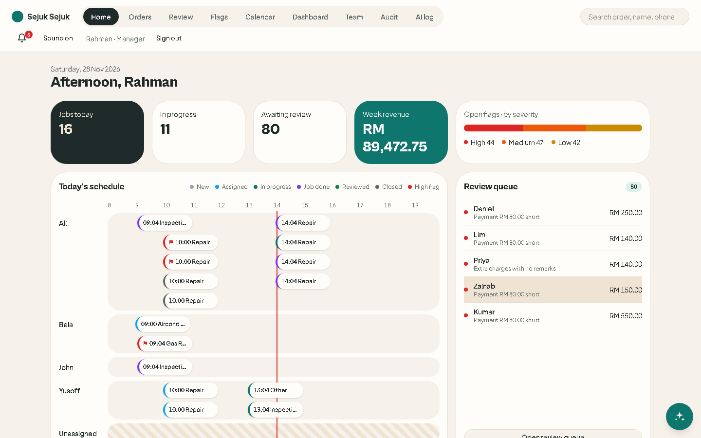
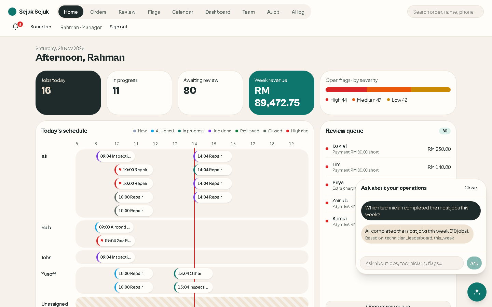
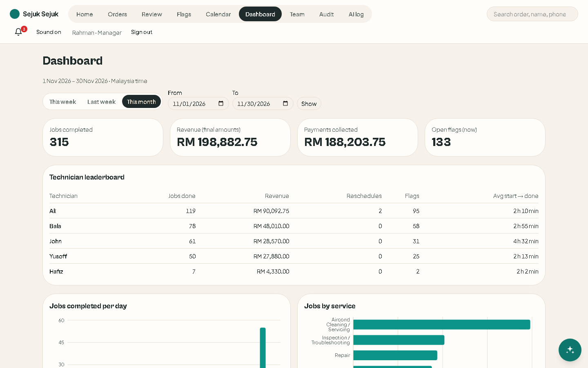
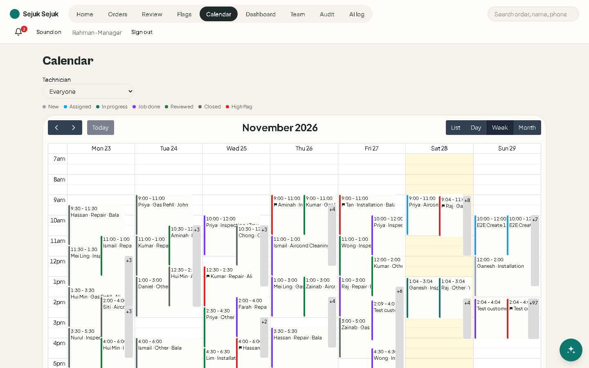
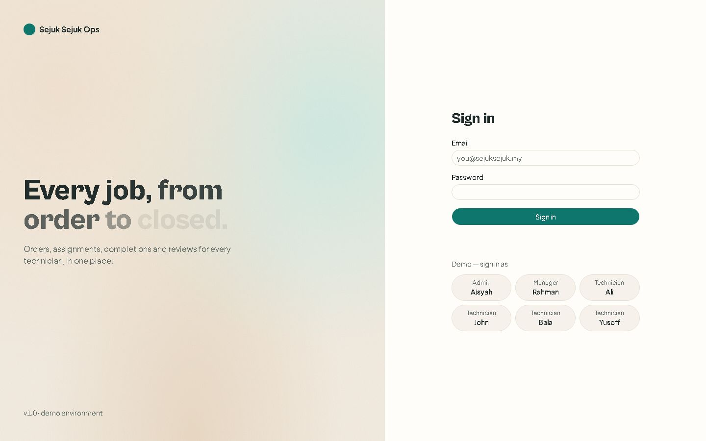
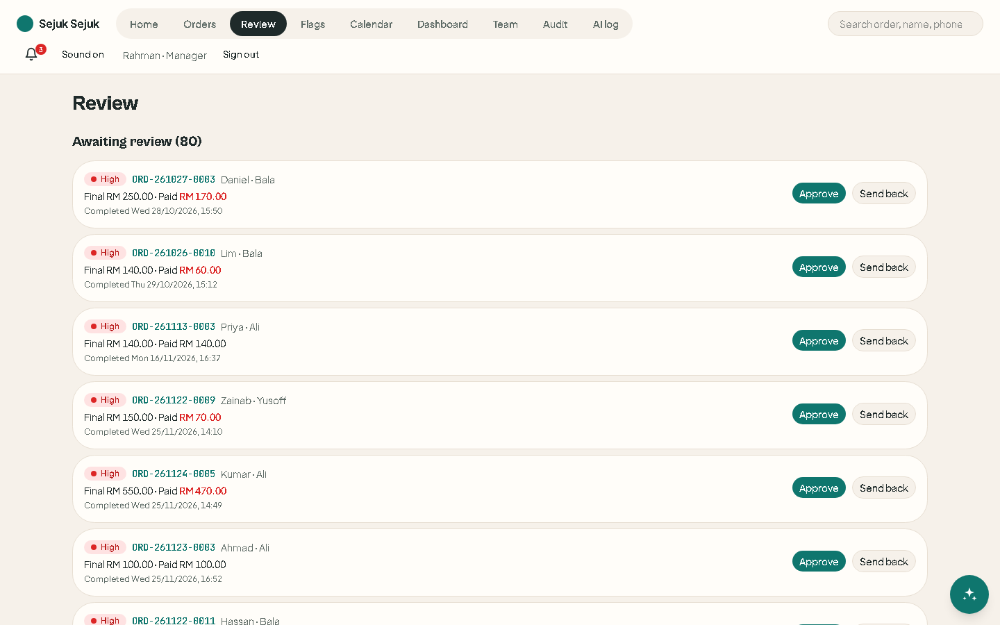
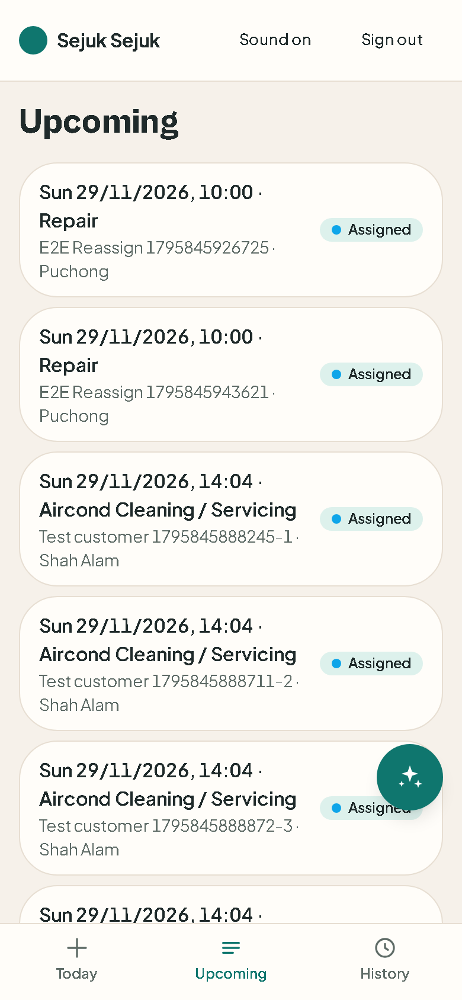
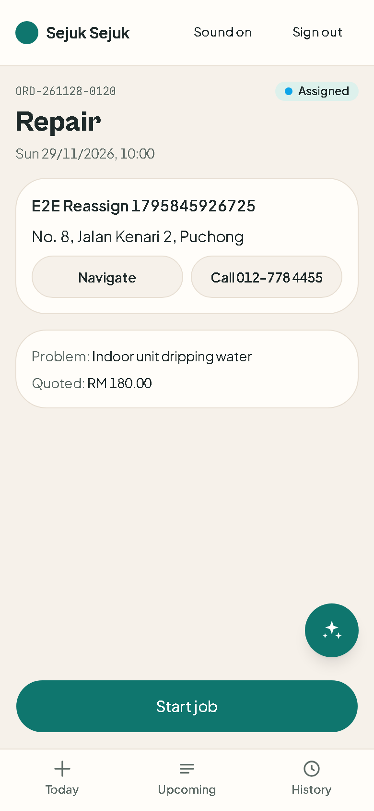
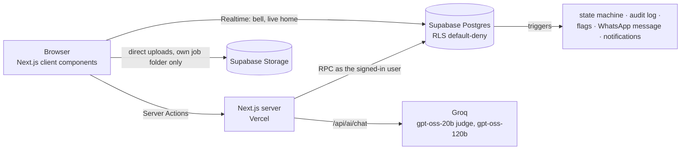

# Sejuk Sejuk Ops

Internal operations system for an air-conditioner service company: **Order → Assignment → Service Completion → Manager Review**, with rule-based issue flags, WhatsApp feedback links, KPIs and a guarded AI assistant.

**Live demo:** https://sejuk-sejuk-roan.vercel.app — one-click sign-in for each role. Planning, requirements, design and test docs: [docs/](docs/README.md).

## Screenshots

| Manager home (C2 schedule bento)                      | AI assistant                                                                    |
| ----------------------------------------------------- | ------------------------------------------------------------------------------- |
|  |  |
| **Dashboard**                                         | **Calendar**                                                                    |
|        |                                    |

| Sign-in                                   | Review queue                                          | Technician jobs (phone)                                     | Technician job (phone)                                    |
| ----------------------------------------- | ----------------------------------------------------- | ----------------------------------------------------------- | --------------------------------------------------------- |
|  |  |  |  |

Regenerate with `SCREENSHOTS=1 CI=1 npx playwright test e2e/screenshots.spec.ts --project=desktop`.

## Demo accounts

| Role       | Account                 | Try                                                                                                |
| ---------- | ----------------------- | -------------------------------------------------------------------------------------------------- |
| Admin      | Aisyah                  | New order → pick a technician (see their day load and clashes) → WhatsApp the technician           |
| Technician | Ali, John, Bala, Yusoff | Open on a phone: start a job, attach photos, record payment, mark done, send the feedback WhatsApp |
| Manager    | Rahman                  | Home schedule, review queue, dashboard, calendar, team, audit log, AI log                          |

Every account can use the round AI button (bottom right). Hafiz is a deactivated technician: his sign-in is refused.

## What was built

| Module                    | What it does                                                                                                                                                                                                                             |
| ------------------------- | ---------------------------------------------------------------------------------------------------------------------------------------------------------------------------------------------------------------------------------------- |
| Orders                    | Admin form; the database generates `ORD-YYMMDD-####`; Malaysian phones normalised to `60…`; technician picker with that day's jobs and a 2-hour clash warning; edit / reassign / reschedule with reasons; search, filters, full timeline |
| Technician (mobile-first) | Today / Upcoming / History; start → complete with work done, extras, remarks, up to 6 photos/videos/PDFs (compressed, retryable), payment and receipt; name and time stamped by the server                                               |
| Review                    | Queue sorted by worst open flag, then oldest; approve, send back with a reason, close (note required when underpaid)                                                                                                                     |
| Flags                     | Automatic on Job Done — High: >20 % over quote, extras without remarks, underpaid; Medium: no files; Low: explained extras, completed >24 h late — plus manual flags; resolve with a note                                                |
| Notifications             | A database trigger writes the customer's WhatsApp feedback message and `wa.me` link; live bell (High flags one by one, other completions grouped per day); sounds with an off switch                                                     |
| Insights                  | C2 schedule-bento home (live); KPI dashboard (this/last week, month, custom; Mon–Sun Malaysia weeks) with leaderboard and charts; calendar; technicians page; audit log                                                                  |
| AI assistant              | Questions answered only from read-only, role-scoped tools; six guardrail stages (five checks plus a blocked log); manager-only log of refused questions                                                                                  |

## Architecture



- **Every write is a role-checked RPC** (`SECURITY DEFINER`, `search_path=''`); signed-in users only have SELECT, filtered by row-level security. A technician can only ever reach their own jobs.
- **The database enforces the workflow**: a trigger rejects any status change not in the state machine, audit triggers record who changed what and why, and the Job Done trigger raises flags, writes the WhatsApp message and notifies staff — even if the change comes from outside the app.
- **Money is integer sen; dates are Malaysia time** (`Asia/Kuala_Lumpur`) end to end, with property tests on the date maths.
- Next.js 16 App Router with Cache Components (partial prerendering); session-dependent parts stream inside Suspense.

Decisions and trade-offs: [design doc](docs/3-design/04-design.md) · interfaces: [API spec](docs/3-design/05-api-spec.md).

## AI design

A question passes five checks; any failure stops it and is written to the blocked log (the sixth stage) ([attack cases](docs/5-testing/ai-attack-cases.md)):

1. **Input screen** — length, control characters, encoded blobs, injection phrasing (Unicode-normalised); also re-screens the chat history the browser sends back. Plus a 20-questions-per-hour limit.
2. **Intent judge** — a small model returns strict JSON (`in_scope` / `out_of_scope` / `malicious`) for the question _and_ its history; anything else blocks.
3. **Main model with tools** — sees only its role's tools (technician 4, admin 6, manager 7), at most 3 calls, arguments validated with Zod.
4. **Tools** — read-only SQL functions run as the user (RLS applies): whitelisted columns only, never free-text notes; customer contact only for staff or the technician currently assigned. Results reach the model inside an `untrusted_data` block.
5. **Output screen** — blocks any order number, phone or street address the tools did not return, and any trace of the system prompt.

Answers show their source ("Based on: technician_leaderboard, this_week"). If the provider fails, the reply is "Assistant unavailable" — no fallback, no partial data.

**Limitations**: English only; answers only what the seven tools cover (no search over remarks); Groq free-tier rate limits; the model words the answer, but every number comes from SQL; bulk "mark reviewed" by AI (a stretch goal) is not built.

## Run locally

Requires Node 24+ and Docker.

```bash
npm install
npm run db:start            # local Supabase in Docker
cp .env.example .env.local  # then fill values from `npx supabase status` (+ GROQ_API_KEY for the AI)
npm run dev                 # http://127.0.0.1:3000
```

## Scripts and tests

| Script             | Does                                                                                            |
| ------------------ | ----------------------------------------------------------------------------------------------- |
| `npm run check`    | lint + typecheck + format check + unit tests (incl. property tests)                             |
| `npm run test:db`  | database tests: RPCs, state machine, RLS per role, audit, flags, KPIs, AI tools                 |
| `npm run test:e2e` | Playwright on desktop and Pixel 7: journeys, accessibility (axe, WCAG 2.2 AA), security headers |
| `npm run db:reset` | rebuild the local database from migrations and seed                                             |

CI runs all of them on every pull request against a throwaway Supabase. Results: [test report](docs/5-testing/09-test-report.md).

## Stack

Next.js 16 · TypeScript (strict) · Tailwind CSS 4 · shadcn/ui · Supabase (Postgres, Auth, Storage, Realtime) · Vercel · Groq · Recharts · FullCalendar. Reasons and trade-offs: [design doc §2](docs/3-design/04-design.md#2-stack-decisions-pros-and-cons). Licences: [CREDITS.md](CREDITS.md).
