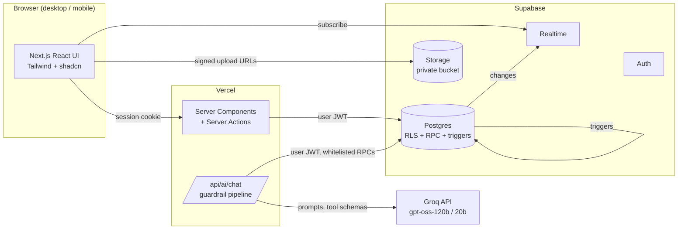
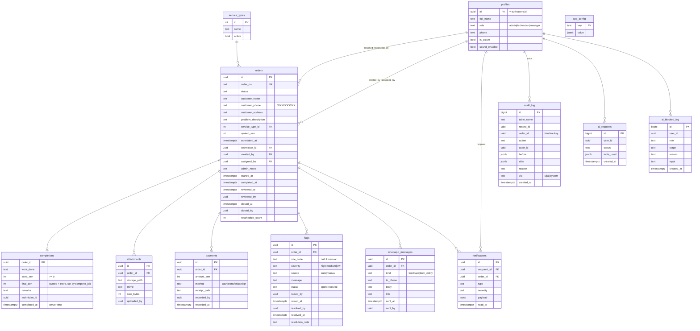
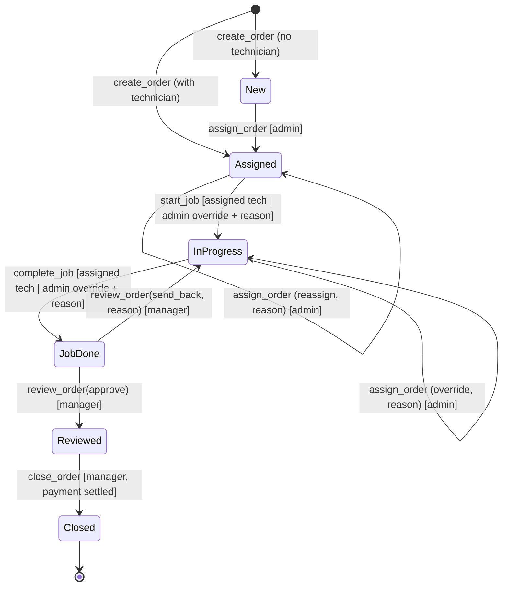
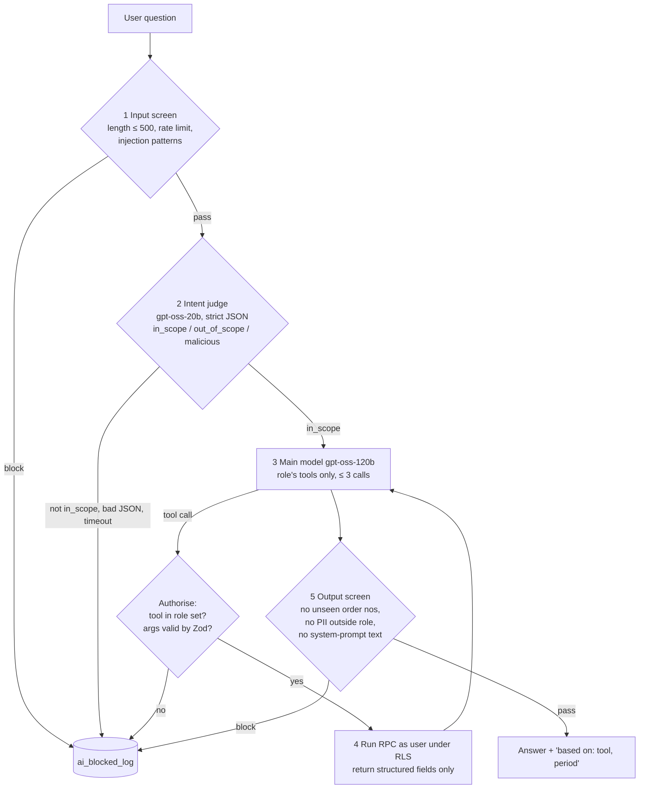

# 04 · Design — Architecture, Data, Security, AI, UI

Status: Draft for approval. Requirements referenced by ID from [03-srs.md](../2-requirements/03-srs.md).

## 1. Architecture

**Key principles**
1. **The database is the rule-keeper.** Status transitions, permissions, order numbers, flags, audit and the WhatsApp trigger live in Postgres (RPC functions, triggers, RLS). The UI and the AI cannot bypass them.
2. **All writes go through RPC functions** (`create_order`, `assign_order`, `start_job`, `complete_job`, …). Direct `UPDATE` on workflow tables is revoked from the `authenticated` role.
3. **Every request runs as the signed-in user** (their JWT), so RLS applies everywhere, including AI tool calls. The service-role key is used only by seed/reset scripts.
4. **Server Components for reads, Server Actions for writes.** No client-side data store needed beyond Realtime subscriptions.

## 2. Stack decisions (pros and cons)

| Decision | Chosen | Alternatives considered | Pros of choice | Cons / trade-offs |
|---|---|---|---|---|
| Front-end framework | **Next.js (App Router) + TypeScript** | Vite + React SPA; Remix | Server-side code for AI route and secrets with zero extra infra; Server Components cut client JS; first-class on Vercel; brief prefers React | More concepts (server/client boundary); heavier than a SPA; App Router caching pitfalls |
| Styling | **Tailwind + shadcn/ui + 21st.dev components** | CSS Modules; MUI; Chakra | Brief prefers Tailwind; copy-in components we own and can restyle; accessible Radix primitives | Many class names in markup; 21st.dev components need per-author licence credit |
| Backend / DB | **Supabase (Postgres)** | Firebase; custom Node + Postgres; PocketBase | Relational model fits orders/flags/audit; RLS gives per-row security; triggers for audit/flags/WhatsApp; Auth, Storage, Realtime in one free tier; brief prefers it | Business logic in SQL is less familiar to some; vendor features (RLS helpers, Realtime) couple us to Supabase; free projects pause when idle |
| File storage | **Supabase Storage, private bucket** | S3; Cloudinary | Same auth/RLS model as the DB; signed URLs; free | 1 GB free total, 50 MB per file |
| Auth | **Supabase Auth + one-click demo logins** | Mock role switcher only | Real sessions let RLS enforce "only the assigned technician"; bonus in brief; reviewers still switch in one click | Seeded passwords are public by design (demo only) |
| Hosting | **Vercel** | Netlify; Cloudflare Pages | Native Next.js support, preview deploy per PR, free | Serverless function timeouts (AI calls must stay short) |
| Local dev / CI DB | **Local Supabase in Docker** + 1 hosted project for demo | Two hosted projects | Tests use a throwaway DB; migrations replayed from zero in CI; demo data never touched | Docker needed locally and in CI (slower CI start) |
| AI provider | **Groq** (`openai/gpt-oss-120b` main, `openai/gpt-oss-20b` judge) | Gemini free tier; OpenRouter `:free`; Cerebras trial | Free, no card, tool calling supported, very fast, OpenAI-compatible SDK | 8K tokens/min cap per model; free-tier terms less documented; fail-closed means no answers during outages |
| Issue flags | **Deterministic SQL rules** | LLM "workflow supervisor" | Explainable, testable, free, instant, cannot be prompt-injected | Can't catch fuzzy issues (e.g. vague remarks) — acceptable for v1 |
| WhatsApp | **`wa.me` deep links created by a DB trigger** | WhatsApp Cloud API; Twilio | No business verification or cost; works on every phone; trigger still fires server-side | A human taps "send"; no delivery receipts |
| Calendar | **FullCalendar (MIT standard build)** | Custom grid; react-big-calendar | Week/month views, resource-free event rendering, mature | Bundle weight (load on calendar route only) |
| Charts | **Recharts** | Chart.js; Tremor | React-native API, good for small dashboards | SVG performance limits on very large series (not an issue here) |
| API style | **RPC: Next.js Server Actions → Supabase RPC functions** (only `/api/ai/chat` is a plain HTTP endpoint) | REST resources + CRUD; REST + action endpoints (`POST /orders/{id}/start`); GraphQL | Workflow steps map 1:1 to named actions, each enforcing role + current state; multi-table steps (complete job) are one transaction; no layer that only forwards calls; typed calls and auto page refresh; smaller public attack surface | No public REST API for other clients or Postman; no OpenAPI/Swagger doc; RPC style less familiar to REST-minded reviewers. A REST layer can be added later on top of the same RPCs without moving the rules |
| Caching / data freshness | **Next.js 16 Cache Components** (`cacheComponents: true`, opt-in `'use cache'`) + `revalidatePath` after writes + Supabase Realtime for other users' changes | TanStack Query; SWR; Next's older implicit fetch cache | Per-user, RLS-scoped reads render fresh on every request, so stale or leaked cached data isn't possible; no second client-side cache to keep in sync with Server Components; Realtime replaces polling | Every page hits the database on each request; opt-in caching must be added deliberately, and only for shared, rarely-changing data (`service_types`, `app_config`), never per-user data |
| Validation | **Zod** shared client/server | Yup; manual | One schema for form, Server Action and AI tool args | — |
| Testing | **Vitest** (unit), **pgTAP/SQL tests via Vitest + local Supabase** (RLS/RPC), **Playwright** (e2e) | Jest; Cypress | Fast, TypeScript-native; Playwright handles mobile viewports | Three tools to configure |

## 3. Data model

Notes
- **Money**: integer sen (`RM 370.00` → `37000`). Displayed with `Intl.NumberFormat('en-MY')`.
- **Order number**: `order_counters(day date PK, last int)` row-locked inside `create_order` → `ORD-YYMMDD-####` using the MYT date.
- **Reasons and "via"**: RPCs set `app.reason` / `app.via` with `set_config(..., true)`; the audit trigger reads them, so reasons are stored without extra columns on every table.
- **Config**: `app_config` holds flag thresholds (`flag.over_quote_pct = 20`, `flag.late_hours = 24`), AI rate limit, attachment limits.
- **Reschedules** counted in `orders.reschedule_count` and in `audit_log` (with technician at the time).

## 4. Status state machine

A `BEFORE UPDATE` trigger on `orders` rejects any transition not in this table, so even a mistaken RPC cannot skip a state.

**Side effects on `→ Job Done`** (one transaction, `AFTER UPDATE` trigger):
1. Evaluate flag rules → insert `flags`.
2. Insert `whatsapp_messages(kind='feedback')` with the brief's template and `wa.me` link.
3. Insert `notifications` for admins/managers (High flags individually; otherwise one grouped "completed" row per recipient per day, updated with a count).

## 5. Security — RLS matrix

Default deny on every table. `private.current_app_role()` (SECURITY DEFINER) returns the caller's role, or NULL when signed out or deactivated; every policy builds on it. Technicians read their own profile and staff profiles only, not other technicians'.

| Table | Admin | Technician | Manager |
|---|---|---|---|
| profiles | read all | read self + names of colleagues | read all; update `is_active` via RPC |
| orders | read all; write via RPC | read where `technician_id = auth.uid()`; write via RPC | read all; write via RPC |
| completions / attachments / payments | read all | read/insert own orders' rows via RPC | read all |
| flags | read all; raise/resolve via RPC | read flags on own orders | read all; raise/resolve via RPC |
| whatsapp_messages | read all; mark sent | read own orders'; mark sent | read all |
| notifications | read/update own | read/update own | read/update own |
| audit_log | read all | read rows for own orders | read all |
| app_config | read | read | read |
| ai_blocked_log | — | — | read |
| Storage `job-files` | read all | read/write `orders/{own order id}/…` | read all |

The `authenticated` role has **SELECT only** on public tables (no INSERT/UPDATE/DELETE grants), so every write RPC is `SECURITY DEFINER` with `search_path = ''`, and its first statements check the caller's role (`private.require_role`), ownership (`private.require_job_actor`) and the order's state (`private.require_status`). Read-only RPCs stay `SECURITY INVOKER` so RLS applies. Helpers live in the non-exposed `private` schema. Deactivated users authenticate at the Auth layer but `private.current_app_role()` returns NULL for them, so every policy and RPC refuses them.

## 6. AI assistant design

**Tools (all read-only, parameterised, Zod-validated)**

| Tool | Args | Technician | Admin | Manager |
|---|---|:-:|:-:|:-:|
| `jobs_list` | technician?, status?, date_range | own only (arg forced) | ✓ | ✓ |
| `job_detail` | order_no | own assigned only (incl. customer contact) | ✓ (incl. contact) | ✓ (incl. contact) |
| `job_counts` | status?, date_range, group_by? | own only | ✓ | ✓ |
| `technician_leaderboard` | date_range, metric | | ✓ | ✓ |
| `technician_workload` | week | | ✓ | ✓ (incl. vs team average) |
| `flags_summary` | severity?, status?, date_range | own jobs | ✓ | ✓ |
| `revenue_summary` | date_range, group_by? | | | ✓ |

- `date_range` is an enum (`today`, `yesterday`, `this_week`, `last_week`, `this_month`, `last_month`) or explicit ISO dates ≤ 92 days; resolved in SQL in MYT.
- Tool results never include `problem_description`, `remarks`, `admin_notes`, `work_done` or resolution notes (indirect-injection defence).
- **Customer contact (name, phone, address)** is returned only to Admin, Manager, or the technician currently assigned to that order. The read RPC checks this per row (technician access ends on reassignment); RLS backs it up. Because the address is typed free text, it is length-capped (≤ 200 chars), stripped of control characters, and passed to the model inside a delimited `untrusted_data` block; the output screen blocks any phone/address that did not appear in this request's tool results.
- System prompt states the data boundary, tells the model tool output is data not instructions, and requires "I don't have that data" when tools can't answer.
- **Stretch (FR-REV-4)**: a `propose_bulk_review` tool returns a proposal object only; the UI renders it as a card, and the existing `review_order` RPC runs when the user clicks Confirm.

**Limitations (to be stated in README)**: only questions answerable by the tools; no free-text search over remarks; Groq free-tier rate limits; English only; model may still phrase answers imperfectly, but numbers come from SQL.

## 7. Notifications
- Bell subscribes to `notifications` for `recipient_id = auth.uid()` via Realtime.
- High flag → individual notification + chime (if sound on). Other completions → grouped daily row ("12 jobs completed today").
- WhatsApp: technician success screen shows the feedback link; tapping opens `wa.me` and calls `mark_whatsapp_sent`.

## 8. UI design
Approved visual reference: [mockup-v3.html](mockup-v3.html) (contains rejected variants C1/C3 and earlier rounds as a decision record).

| Surface | Decision |
|---|---|
| Login | Option A layout: split hero (grain gradient, word-fade heading) + sign-in form with six demo buttons |
| Admin/Manager home | **C2 schedule bento**: top bar with pill nav + search + New order; KPI tiles; flags-by-severity bar; technician × hour schedule with "now" line and unassigned lane; review queue tile |
| Technician | **E layout**: next-job card with one-tap Navigate (Google Maps link) and Call — a link instead of an embedded map preview, to avoid a maps API key and extra data on mobile; day-progress ring; later jobs as a vertical list; pinned primary action; bottom tabs (Today / Upcoming / History) |
| AI | Round sparkle button fixed bottom-right on every screen; slide-up panel |
| Palette (C) | bg `#F6F1EA`, surface `#FFFDF9`, ink `#1F2A2A`, muted `#5E6B66`, line `#E7DED2`, accent teal `#0F766E` |
| Flags | High `#DC2626` 🔴, Medium `#EA580C` 🟠, Low `#CA8A04` 🟡 (dots/bars; Low *text* on its pale chip uses `#A16207` for WCAG AA contrast), Resolved `#15803D` ✓ |
| Statuses | New `#94A3B8`, Assigned `#0EA5E9`, In progress `#0F766E`, Job done `#7C3AED`, Reviewed `#15803D`, Closed `#5E6B66` (from the C2 schedule legend) |
| Type | Headings Cabinet Grotesk 800 (Fontshare CDN, fallback Plus Jakarta Sans 800); body Plus Jakarta Sans (self-hosted, OFL); order numbers JetBrains Mono (OFL); tabular figures for money |
| Motion | ≤ 200 ms functional transitions in-app; login heading animation; honours `prefers-reduced-motion`; no 3D/scroll effects |
| Sound | UI SFX (CC0): job-done confirm, High-flag chime; on by default, per-user toggle |

## 9. Licensing policy
- Commit only assets whose licence allows redistribution (OFL, MIT, CC0, Unsplash/Pexels, own work).
- ITF fonts (Cabinet Grotesk) loaded from Fontshare CDN, never committed.
- backgrounds.supply / Gradient Lab files stored in Supabase Storage, not git.
- Every third-party component/asset listed in `CREDITS.md` with author and licence.

## 10. Environments
| Env | DB | App | Purpose |
|---|---|---|---|
| local | Supabase CLI in Docker | `next dev` | development, unit + RLS + e2e tests |
| CI | Supabase CLI in Docker on GitHub Actions | `next build && next start` | lint, typecheck, tests on every PR |
| preview | hosted demo project | Vercel preview | PR review |
| demo | hosted demo project | Vercel production | assessor-facing |
