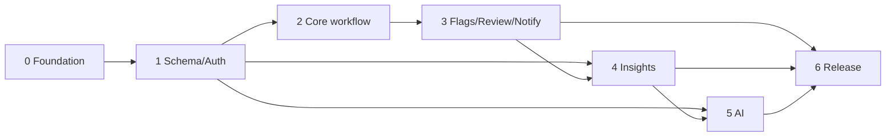

# 06 · Implementation Plan

Status: Draft for approval. One branch + PR per phase; each PR passes CI (lint, typecheck, unit, RLS, e2e) and `/code-review` before merge. TDD on logic marked 🧪.

Estimates are focused working hours (≈ 40 h of the 64 h window; the rest is buffer, review and sleep).

## Phase 0 — Foundation (≈ 5 h) · branch `chore/foundation`
| # | Task | Est |
|---|---|---|
| 0.1 | Create GitHub repo, protect `main`, Next.js + TS strict + Tailwind + ESLint + Prettier scaffold | 1 h |
| 0.2 | shadcn/ui init; theme tokens from design §8; fonts (Jakarta + JetBrains self-hosted, Cabinet via CDN) | 1 h |
| 0.3 | Supabase CLI local stack; `.env.example`; Supabase SSR client helpers | 1 h |
| 0.4 | Vitest + Playwright setup; GitHub Actions CI (Supabase in Docker, migrations, tests) | 1.5 h |
| 0.5 | Vercel project linked; hosted Supabase demo project; preview deploys | 0.5 h |

## Phase 1 — Schema, rules, auth (≈ 8 h) · branch `feat/schema-auth`
| # | Task | Est |
|---|---|---|
| 1.1 | Migrations: tables, enums, indexes per design §3 | 1.5 h |
| 1.2 | 🧪 Order-number generator + `create_order` (concurrency test) | 1 h |
| 1.3 | 🧪 State-machine guard trigger + transition RPCs (`assign`, `start`, `complete`, `review`, `close`, `reschedule`, `update`) | 2 h |
| 1.4 | 🧪 Audit trigger (reason/via via `set_config`) | 0.5 h |
| 1.5 | 🧪 RLS policies + per-role RLS integration tests; storage bucket policies | 1.5 h |
| 1.6 | Seed script: users (2 admins, 1 manager, 4 techs), service types, ~6 weeks of orders in every status incl. flags and reschedules; `reset-demo` script | 1 h |
| 1.7 | Login page (A layout) + demo buttons + role-based redirect + deactivated check | 0.5 h |

## Phase 2 — Core workflow UI (≈ 9 h) · branch `feat/core-workflow`
| # | Task | Est |
|---|---|---|
| 2.1 | App shell: top bar + pill nav (desktop), bottom tabs (mobile), AI button placeholder | 1 h |
| 2.2 | Admin order form (Zod schema shared), phone normalisation 🧪, technician picker with day load/clash warning, post-submit summary + "notify technician" link | 2 h |
| 2.3 | Order list (search, filters, pagination via URL state) + order detail (fields, attachments, flags, payment, audit timeline) | 2 h |
| 2.4 | Edit / reassign / reschedule / override dialogs with reasons | 1 h |
| 2.5 | Technician Today/Upcoming/History (E layout), Start job | 1 h |
| 2.6 | 🧪 Final-amount maths; completion form; signed-URL uploads with compression, per-file retry, limits; payment fields; Mark job done | 2 h |

## Phase 3 — Flags, review, notifications (≈ 6 h) · branch `feat/flags-review-notify`
| # | Task | Est |
|---|---|---|
| 3.1 | 🧪 Flag rule evaluation in SQL (thresholds from `app_config`), property tests on thresholds | 1.5 h |
| 3.2 | Manual raise / resolve flag UI; severity sorting; flags page | 1 h |
| 3.3 | Review queue + approve / send back / close | 1 h |
| 3.4 | 🧪 Job-done trigger → WhatsApp message + link; technician success screen; resend; `mark_whatsapp_sent` | 1 h |
| 3.5 | Notification bell (Realtime), grouping, High-flag chime + job-done sound (UI SFX), per-user sound toggle | 1.5 h |

## Phase 4 — Home, KPIs, calendar, team (≈ 6 h) · branch `feat/insights`
| # | Task | Est |
|---|---|---|
| 4.1 | 🧪 KPI SQL functions (MYT week bucketing, property tests on date ranges) | 1.5 h |
| 4.2 | C2 schedule-bento home (KPI tiles, flags bar, technician × hour schedule, review queue) | 2 h |
| 4.3 | Dashboard page: cards, leaderboard, Recharts charts, period switcher | 1.5 h |
| 4.4 | Calendar (FullCalendar week/month, technician filter) | 0.5 h |
| 4.5 | Technicians page: deactivate/reactivate | 0.5 h |

## Phase 5 — AI assistant (≈ 6 h) · branch `feat/ai-assistant`
| # | Task | Est |
|---|---|---|
| 5.1 | Read RPCs for AI tools with column whitelists | 1 h |
| 5.2 | 🧪 Stage 1 input screen + rate limit | 0.5 h |
| 5.3 | 🧪 Stage 2 intent judge (strict JSON, fail-closed on timeout/parse) | 1 h |
| 5.4 | 🧪 Stage 3–4 tool loop: role tool sets, server-side authorisation, Zod args, ≤ 3 calls | 1.5 h |
| 5.5 | 🧪 Stage 5 output screen; blocked log + manager page | 1 h |
| 5.6 | Chat panel UI (round button, sources line, example questions per role) | 1 h |

## Phase 6 — Hardening and delivery (≈ 5 h) · branch `chore/release`
| # | Task | Est |
|---|---|---|
| 6.1 | Playwright e2e: admin create/assign → tech complete (mobile viewport) → manager review/close; AI happy path + one blocked attack | 1.5 h |
| 6.2 | Security headers/CSP, accessibility pass, reduced motion, Lighthouse on technician home | 1 h |
| 6.3 | Deploy demo, run seed, smoke test | 0.5 h |
| 6.4 | Docs 07–13, README, `CREDITS.md`, screenshots | 2 h |

## Stretch (only if Phases 0–6 are done)
1. AI `propose_bulk_review` + Confirm card (≈ 1.5 h)
2. Full job transfer with reason list (≈ 2 h)

## Cut order if behind schedule
1. Stretch items
2. Calendar (FR-CAL-1, Should) → link to filtered order list instead
3. Sounds (FR-NOT-4)
4. Dashboard charts (FR-KPI-3) — keep cards and leaderboard
5. Payment receipt photo (keep amount/method)

Never cut: RLS, state machine, audit, flags, WhatsApp trigger, AI guardrails, e2e core flow.

## Dependencies

